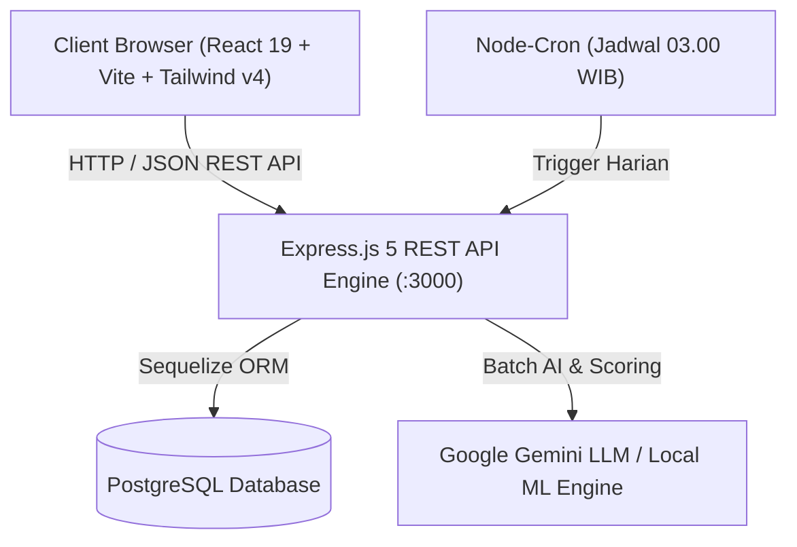

# 🏛️ LaporSarpras AI — Universitas Muhammadiyah Yogyakarta

> **Sistem Pelaporan dan Pengelolaan Kerusakan Sarana Prasarana Kampus Berbasis Kecerdasan Buatan (AI)**  
> *Proyek Akhir Perancangan Manajemen Proyek Teknologi Informasi — Kelompok 5 TI UMY 2026*

---

## 📋 Daftar Isi
1. [Tentang Sistem](#-tentang-sistem)
2. [Fitur Unggulan](#-fitur-unggulan)
3. [Arsitektur & Tech Stack](#-arsitektur--tech-stack)
4. [Struktur Direktori Proyek](#-struktur-direktori-proyek)
5. [Role-Based Access Control (RBAC)](#-role-based-access-control-rbac)
6. [Panduan Instalasi & Menjalankan](#-panduan-instalasi--menjalankan)
7. [Akun Pengujian (Testing Credentials)](#-akun-pengujian-testing-credentials)
8. [Dokumentasi RESTful API](#-dokumentasi-restful-api)
9. [Sistem Desain & Design Tokens (Figma)](#-sistem-desain--design-tokens-figma)
10. [Keamanan & Validasi Sistem](#-keamanan--validasi-sistem)

---

## 📌 Tentang Sistem

**LaporSarpras AI** adalah platform terintegrasi generasi modern yang memfasilitasi pelaporan fasilitas kampus yang rusak (AC, proyektor, kelistrikan, sanitasi, meja/kursi) oleh mahasiswa dan sivitas akademika, serta manajemen perbaikan oleh Biro Sarana & Prasarana UMY.

Aplikasi telah sepenuhnya dimigrasikan dari template engine warisan (EJS) ke arsitektur decoupled **React 19 + TypeScript + Tailwind CSS v4 + Vite** sebagai frontend Single Page Application (SPA), dengan backend **Express.js REST API**, ORM **Sequelize**, basis data **PostgreSQL**, dan integrasi **Google Gemini AI**.

---

## 🚀 Fitur Unggulan

### 1. 🚪 Single Portal Login (Satu Pintu Terpadu: NIM atau Email)
- Tidak ada halaman login terpisah yang membingungkan antara mahasiswa dan staf.
- Menggunakan 1 landing page autentikasi terpusat.
- **Login Fleksibel:** Pengguna dapat masuk menggunakan **NIM Mahasiswa** (contoh: `20240140151`) **ATAU Alamat Email Kampus/Gmail** (contoh: `rasyid.aqim@mail.umy.ac.id`), serta ID Staf (`admin_sarpras` / `sarpras@umy.ac.id`).
- Sistem secara otomatis mengidentifikasi kredensial pengguna dan langsung mengarahkan (*auto-redirect*) ke antarmuka yang sesuai dengan hak akses masing-masing.

### 2. 📱 Universal QR Code & Input Cerdas Anti-XSS
- Menggunakan konsep **1 QR Code untuk Semua Ruangan Kampus** yang dapat ditempel di setiap lorong/gedung.
- Pengguna cukup memindai satu kode QR untuk membuka portal, kemudian mengisi lokasi spesifik (contoh: `Gedung F6 L2 R.204`).
- Dilengkapi pembatasan ketat **maksimal 35 karakter** dan sanitasi otomatis dari karakter berbahaya (Anti-XSS Security Injection Prevention).

### 3. 🚨 Mode Kondisi Mendesak (Red Alert Triage)
- Fitur pelaporan cepat untuk situasi darurat dan bahaya keselamatan (seperti korsleting listrik berpercik api, pipa bocor membanjiri ruang server, plafon retak runtuh).
- Membutuhkan lampiran foto bukti fisik wajib.
- Mengaktifkan SLA (Service Level Agreement) darurat **1–2 jam respons cepat**.
- Menampilkan panel merah kedaruratan khusus pada Dashboard Admin Sarpras untuk verifikasi instan.

### 4. 🤖 Mesin AI Clustering & Severity Scoring
- Didukung oleh model **Google Gemini API** dan **Local Machine Learning / Rule-Engine Fallback**.
- **Batch Clustering Harian (Cron 03.00 WIB):** Secara otomatis mengelompokkan laporan-laporan serupa pada lokasi atau fasilitas yang sama menjadi satu tiket induk (*Parent Ticket*) untuk efisiensi teknisi.
- **Sinkronisasi Status Otomatis:** Perubahan status pada tiket induk secara berantai (*cascade*) memperbarui seluruh tiket anak.

### 5. 🔍 Pelacakan Tiket Publik Real-Time
- Pelapor dapat memantau perkembangan penanganan langsung menggunakan kode unik `#TKT-YYYYMMDD-XXXX`.
- Pelacakan dapat diakses secara publik tanpa perlu login.
- Dilengkapi **4-Step Stepper Linimasa** (*Terkirim ➔ Diterima ➔ Diproses ➔ Selesai*) serta catatan audit log transparansi teknisi.

---

## 🛠️ Arsitektur & Tech Stack



| Lapisan | Teknologi | Versi / Keterangan |
| :--- | :--- | :--- |
| **Frontend Framework** | React | `^19.0.0` (Modern Functional Components & Hooks) |
| **Language** | TypeScript | `^5.7.0` (Strict Type Safety) |
| **Styling & CSS** | Tailwind CSS | `^4.0.0` (Engine v4 berbasis Vite Plugin) |
| **Bundler & Tooling** | Vite | `^8.0.5` (Instant HMR & Optimized Build) |
| **Typography** | Google Fonts | *Bricolage Grotesque* & *Inter* |
| **Backend Framework**| Express.js | `^5.3.0` (RESTful Architecture) |
| **Session Management**| Express-Session | Cookie-based session dengan flag `HttpOnly` & `SameSite` |
| **File Upload** | Multer | Upload foto bukti laporan (Maks. 5 MB) |
| **Database & ORM** | PostgreSQL & Sequelize | `pg ^8.23.1`, `sequelize ^6.37.8` |
| **AI / Machine Learning**| Google Gemini API | Model multimodal LLM + Rule Engine fallback |
| **Task Scheduler** | Node-Cron | Penjadwalan klaster otomatis setiap pukul 03.00 WIB |

---

## 📂 Struktur Direktori Proyek

Semua tampilan frontend React terisolasi rapi di folder root `views/`, terpisah tegas berdasarkan hak akses:

```text
LaporSarpras/
├── app.js                       # Entry point Express backend server & static serving
├── index.html                   # HTML template Vite (memuat Google Fonts)
├── vite.config.ts               # Konfigurasi Vite & proxy dev API
├── tsconfig.json                # Konfigurasi TypeScript & path alias
├── package.json                 # Daftar dependencies & npm scripts
├── .env                         # Konfigurasi database & environment variables
│
├── views/                       # 🌟 FRONTEND REACT & TYPESCRIPT SOURCE
│   ├── main.tsx                 # Root mounter ReactDOM
│   ├── index.tsx                # Single Portal App Router & RBAC Navigation
│   ├── index.css                # Tailwind v4 theme, Figma color tokens & reset
│   │
│   ├── mahasiswa/               # Khusus Hak Akses Mahasiswa & Publik
│   │   ├── ReportForm.tsx       # Formulir pengaduan (35 char limit + Anti-XSS)
│   │   ├── SuccessScreen.tsx    # Layar tiket terkirim & ringkasan aduan
│   │   ├── TrackingTimeline.tsx # Pelacak 4-step stepper linimasa & catatan teknisi
│   │   └── MyReports.tsx        # Daftar riwayat aduan milik mahasiswa yang login
│   │
│   ├── admin/                   # Khusus Hak Akses Admin Biro Sarpras
│   │   ├── AdminDashboard.tsx   # Dashboard operasional, KPI cards & pemicu AI
│   │   ├── TriagePanel.tsx      # Panel darurat Red Alert (SLA 1-2 jam)
│   │   ├── ClusterTable.tsx     # Tabel pengelompokan laporan kluster AI
│   │   └── ReportList.tsx       # Tabel master seluruh pengaduan & update status
│   │
│   ├── components/              # Komponen reusable
│   │   ├── Header.tsx           # App Bar hijau emerald #0F6B5C (H-70px)
│   │   └── Logo.tsx             # Badge ikon logo LaporSarpras
│   │
│   ├── services/
│   │   └── api.ts               # HTTP client Axios/Fetch untuk seluruh REST API
│   │
│   └── types/
│       └── index.ts             # Interface TypeScript data model
│
├── controllers/
│   └── ApiController.js         # REST API Controller (Auth, Reports, Admin, Triage)
│
├── routes/
│   └── api.js                   # Endpoint routing REST API Express
│
├── models/                      # Sequelize Data Models
│   ├── index.js                 # Inisialisasi asosiasi & relasi antar tabel
│   ├── User.js                  # Model pengguna (mahasiswa & admin)
│   ├── Report.js                # Model pengaduan fasilitas
│   ├── ReportStatusLog.js       # Log audit perubahan status
│   ├── EmergencyVerification.js # Log verifikasi kedaruratan
│   └── AIAnalysisResult.js      # Hasil inferensi analisis & kluster AI
│
├── config/
│   ├── database.js              # Koneksi PostgreSQL Sequelize
│   ├── cron.js                  # Scheduler node-cron pukul 03.00 WIB
│   └── aiPrompt.js              # System prompt & Few-Shot reasoning Gemini AI
│
├── middlewares/
│   ├── authMiddleware.js        # Proteksi hak akses session (Admin / Mahasiswa)
│   └── uploadMiddleware.js      # Filter dan storage upload gambar Multer
│
├── services/
│   ├── aiService.js             # Orkestrasi analisis Gemini API & clustering
│   └── fallbackRuleEngine.js    # Rule-based scoring lokal saat offline
│
└── public/
    └── uploads/                 # Direktori penyimpanan foto bukti fisik aduan
```

---

## 🔐 Role-Based Access Control (RBAC)

Aplikasi menerapkan pengamanan ganda (*Two-Tier RBAC Enforcement*):

1. **Client-Side Guard (React Router):** State `user.role` mengunci komponen `views/admin/` dari pengguna berstatus `mahasiswa`. Jika mahasiswa mencoba berpindah ke layar admin, sistem otomatis menolak dan mengembalikannya ke halaman pelaporan.
2. **Server-Side Guard (Express API Middleware):** Semua endpoint berawalan `/api/admin/*` diverifikasi oleh middleware `requireAdmin` yang memeriksa sesi aktif di sisi server. Permintaan ilegal menghasilkan respon `403 Forbidden`.

| Fitur / Layar | Mahasiswa | Admin Sarpras | Publik (Tanpa Login) |
| :--- | :---: | :---: | :---: |
| Masuk Portal (*Single Login*) | ✅ | ✅ | ❌ |
| Input Laporan Sarpras Baru | ✅ | ❌ | ❌ |
| Upload Foto Bukti & Kedaruratan | ✅ | ❌ | ❌ |
| Melihat "Laporan Saya" | ✅ | ❌ | ❌ |
| Lacak Status Tiket Linimasa | ✅ | ✅ | ✅ |
| Panel Triage Kedaruratan (*Red Alert*) | ❌ | ✅ | ❌ |
| Jalankan AI Batch Clustering | ❌ | ✅ | ❌ |
| Update Status & Catatan Teknisi | ❌ | ✅ | ❌ |
| Lepas Hubungan Kluster (*Unlink*) | ❌ | ✅ | ❌ |

---

## ⚡ Panduan Instalasi & Menjalankan

### 1. Prasyarat Sistem
- **Node.js:** Versi `>= 18.x` atau `>= 20.x`
- **PostgreSQL Database:** Versi `>= 14`
- **Git**

### 2. Kloning Repositori & Instal Dependensi
```bash
git clone <URL_REPOSITORY>
cd LaporSarpras

# Instal seluruh dependensi backend dan frontend
npm install
```

### 3. Konfigurasi Lingkungan (`.env`)
Pastikan file `.env` di direktori root sudah terisi sesuai konfigurasi lokal Anda:
```env
APP_PORT=3000

# Konfigurasi Basis Data PostgreSQL
DB_HOST=localhost
DB_PORT=5432
DB_USER=postgres
DB_PASSWORD=ahmed
DB_NAME=laporsarpras_db
DB_DIALECT=postgres

# Konfigurasi Google Gemini AI
GEMINI_API_KEY=your_gemini_api_key_here
GEMINI_MODEL=gemini-1.5-flash
```

### 4. Menyiapkan Basis Data
Pastikan database bernama `laporsarpras_db` sudah dibuat di PostgreSQL Anda. Jalankan migrasi dan seeder jika tersedia:
```bash
npx sequelize-cli db:migrate
npx sequelize-cli db:seed:all
```

### 5. Menjalankan Aplikasi

#### Opsi A: Mode Produksi Terpadu (Single Port 3000)
Vite akan mem-bundle frontend ke folder `dist/`, dan Express backend akan menyajikan API sekaligus aplikasi web di port `3000`:
```bash
# 1. Build aset frontend React
npm run build

# 2. Jalankan server aplikasi
npm start
```
Buka browser di: **`http://localhost:3000`**

#### Opsi B: Mode Pengembangan (*Development / Hot Reload*)
Untuk kemudahan pengembangan antarmuka dengan Vite Hot-Module-Replacement:
```bash
# Terminal 1: Backend API
npm run dev:server

# Terminal 2: Vite Dev Server
npm run dev
```
Buka antarmuka dev di: **`http://localhost:5173`** (otomatis melakukan proxy API ke `:3000`).

---

## 🔑 Akun Pengujian (Testing Credentials)

Untuk menguji alur kerja lengkap dan pengujian role-based redirect, gunakan akun bawaan (*seed*):

| Peran | NIM / ID Pengguna | Email | Kata Sandi | Arah Navigasi Otomatis |
| :--- | :--- | :--- | :--- | :--- |
| **Mahasiswa** | `20240140151` | `rasyid.aqim@mail.umy.ac.id` | `password123` | Form Pelaporan & Riwayat Saya |
| **Admin Sarpras** | `admin_sarpras` | `sarpras@umy.ac.id` | `password123` | Dashboard Pusat Kendali Operasional |

---

## 📡 Dokumentasi RESTful API

### 1. Autentikasi (`/api/auth`)
- `POST /api/auth/login`  
  **Body:** `{ "nomor_identitas": "...", "password": "..." }`  
  **Deskripsi:** Memverifikasi kredensial dan membentuk session pengguna.
- `GET /api/auth/me`  
  **Deskripsi:** Mengembalikan informasi profil dan peran pengguna yang sedang login.
- `POST /api/auth/logout`  
  **Deskripsi:** Menghancurkan session pengguna.

### 2. Pelaporan & Pelacakan (`/api/reports`)
- `POST /api/reports` (Multipart Form)  
  **Form Data:** `kode_lokasi`, `nama_fasilitas`, `deskripsi_kerusakan`, `is_urgent_claimed`, `jenis_bahaya`, `durasi_masalah`, `foto` (file).  
  **Deskripsi:** Membuat laporan kerusakan baru. Menghasilkan kode tiket acak format `#TKT-YYYYMMDD-XXXX`.
- `GET /api/reports/my`  
  **Deskripsi:** Mengambil seluruh riwayat laporan milik mahasiswa yang sedang login.
- `GET /api/reports/:ticketNumber`  
  **Deskripsi:** Endpoint publik untuk memantau detail tiket, status, tahapan stepper (1-4), dan riwayat catatan penanganan teknisi.

### 3. Operasional Admin Sarpras (`/api/admin`) *(Memerlukan Role Admin)*
- `GET /api/admin/dashboard`  
  **Deskripsi:** Mengambil metrik KPI (Total, Mendesak, Diproses, Selesai), daftar laporan bahaya untuk triage, dan kluster AI.
- `POST /api/admin/triage/:reportId`  
  **Body:** `{ "action": "verify" | "dismiss", "catatan": "..." }`  
  **Deskripsi:** Melakukan verifikasi kedaruratan atau menurunkan prioritas laporan.
- `POST /api/admin/batch-ai`  
  **Deskripsi:** Memicu eksekusi manual siklus pengelompokan (*batch clustering*) dan analisis urgensi AI.
- `POST /api/admin/reports/:reportId/status`  
  **Body:** `{ "status": "Diproses" | "Selesai" | "Ditolak", "catatan": "..." }`  
  **Deskripsi:** Memperbarui status penanganan laporan beserta catatan teknisi (otomatis tersinkronisasi ke seluruh anak kluster).
- `POST /api/admin/reports/:reportId/unlink`  
  **Deskripsi:** Melepas hubungan suatu laporan dari tiket induk kluster jika ternyata kerusakannya berbeda.

---

## 🎨 Sistem Desain & Design Tokens (Figma)

Desain antarmuka mematuhi spesifikasi desain resmi sistem LaporSarpras:

| Token Desain | Nilai HEX / Ukuran | Penggunaan |
| :--- | :--- | :--- |
| **Primary Emerald** | `#0F6B5C` | Header bar, tombol utama, tautan aktif, aksen brand |
| **Primary Hover** | `#0C574A` | State hover tombol primer |
| **Light Teal Tint** | `#EDF7F4` | Kartu informasi, dropzone unggah, latar tiket |
| **Page Background** | `#F5F6F2` | Latar belakang seluruh halaman aplikasi |
| **Surface White** | `#FFFFFF` | Latar belakang kartu form, tabel, dan card dashboard |
| **Charcoal Dark** | `#14201E` | Teks judul utama (*H1, H2, Heading*) |
| **Muted Slate** | `#5F6E6A` | Teks keterangan pendukung, subtitle, waktu linimasa |
| **Border Soft** | `#DCE1DC` | Garis tepi (*border*) input, form, dan kartu |
| **Red Alert / Urgent** | `#A8261D` | Aksen bahaya, mode darurat, tombol bahaya |
| **Red Tint** | `#F9E1DE` / `#FFF8F7` | Kartu triage kedaruratan, badge madesak |
| **Amber Warning** | `#8A5A00` / `#FBEACB` | Status "Diproses", indikator penanganan |
| **Green Success** | `#256B43` / `#DDF0E3` | Status "Selesai", tanda verifikasi sukses |
| **Header Height** | `70px` | Tinggi fixed bilah navigasi utama |
| **Corner Radius** | `10px` (Input/Button), `14px` (Card) | Kelengkungan sudut elemen |

---

## 🛡️ Keamanan & Validasi Sistem

1. **Sanitasi Input Anti-XSS (Cross-Site Scripting):**
   Setiap input teks lokasi ruangan disaring melalui ekspresi reguler `replace(/[<>"'/`]/g, '')` pada client-side dan sanitasi Sequelize pada server-side guna menggagalkan upaya injeksi tag script HTML atau payload berbahaya.
2. **Batasan Ketat Karakter (35 Char Limit):**
   Input lokasi ruangan dibatasi maksimal 35 karakter dengan penghitung sisa karakter (*character counter*) interaktif.
3. **Validasi File Upload yang Ketat:**
   - Hanya menerima format gambar bereksistensi valid: `.jpg`, `.jpeg`, `.png`, `.webp`.
   - Pembatasan ukuran berkas maksimal **5 MB**.
   - Berkas disimpan dengan penamaan UUID acak untuk menghindari penimpaan file (*file collision*) atau serangan *directory traversal*.
4. **Session Cookie Security:**
   Sesi login dikonfigurasi dengan flag `HttpOnly` untuk menangkal pencurian sesi via JavaScript, serta `SameSite: 'lax'` untuk mitigasi CSRF (Cross-Site Request Forgery).

---

## 👥 Pengembang & Kontributor

- **Mata Kuliah:** Manajemen Proyek Teknologi Informasi
- **Program Studi:** Teknologi Informasi — Fakultas Teknik
- **Institusi:** Universitas Muhammadiyah Yogyakarta
- **Tahun:** 2026

*© 2026 LaporSarpras AI Team — Kelompok 5 TI UMY. Seluruh hak cipta dilindungi undang-undang.*
